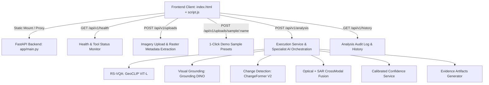

# SatQuery AI • Frontend & Backend Integration Walkthrough

Successfully connected the interactive Vision-Language Remote Sensing frontend with the FastAPI backend for **SIH26167: Interactive Vision-Language Assistant for Multimodal Remote Sensing Image Analysis**.

---

## Key Integrations & Architecture



---

## Changes Summary

### 1. Backend Enhancements
- **Static Mounting & Direct Serving** in [`backend/app/main.py`](file:///c:/Users/Lenovo/Documents/SatQuery_SIH/SatQuery/backend/app/main.py):
  - Mounted `frontend/` at root `/` to serve `index.html`, `style.css`, and `script.js` seamlessly from the same origin.
  - Mounted `storage/uploads` and `storage/evidence` for generated raster images and spatial overlays.
  - Mounted `backend/sample_data` at `/sample_data`.
  - Added `/api` route info endpoint.
- **Sample Preset Loading Endpoint** in [`backend/app/api/routes/uploads.py`](file:///c:/Users/Lenovo/Documents/SatQuery_SIH/SatQuery/backend/app/api/routes/uploads.py):
  - Added `POST /api/v1/uploads/sample/{sample_name}` to load pre-bundled sample rasters with automatic geospatial metadata extraction (`EPSG:4326`, resolution, band count).

### 2. Frontend Modernization & Backend Connection
- **Live Health & Status Monitoring** in [`frontend/index.html`](file:///c:/Users/Lenovo/Documents/SatQuery_SIH/SatQuery/frontend/index.html) and [`frontend/script.js`](file:///c:/Users/Lenovo/Documents/SatQuery_SIH/SatQuery/frontend/script.js):
  - Automatically queries `/api/v1/health` on load and updates the navbar badge with live status (`🟢 Backend: Online (v1.0.0)`).
- **1-Click Interactive Demo Presets**:
  - `🛰️ Single-Image VQA`: Preloads `optical_sample.png` + Land cover query.
  - `🎯 Visual Grounding`: Preloads `optical_sample.png` + Target localization query.
  - `🔄 Change Detection (T1 vs T2)`: Preloads `t1_sample.png` & `t2_sample.png` + Change detection query.
  - `📡 Optical + SAR Fusion`: Preloads `optical_sample.png` & `sar_sample.png` + Cross-modal penetration query.
- **Raster Metadata Badges**:
  - Inspects raster dimensions (`512×512`), CRS (`EPSG:4326`), band count, and georeferenced status directly upon upload.
- **Full AI Analysis Pipeline Execution**:
  - Connects to `POST /api/v1/analysis` with stage-by-stage loading animation.
  - Displays rich formatted AI reasoning answers, tool badges, and latency.
- **Calibrated Confidence Meter**:
  - Score percentage meter (`88% - 95%`), confidence level badge (`HIGH`, `MEDIUM`, `LOW`), cross-modal agreement, and itemized factor tags.
- **Visual Evidence Lightbox Gallery**:
  - Renders generated bounding box overlays, change detection difference heatmaps, and side-by-side coregistered comparisons.
  - Interactive click-to-zoom Lightbox modal for high-resolution raster inspection.
- **Collapsible Execution Trace Telemetry**:
  - Step-by-step breakdown of time spent on `INPUT_LOADING`, `QUERY_PLANNING`, `GEOSPATIAL_VALIDATION`, specialist tool execution, and `CONFIDENCE_SYNTHESIS`.
- **Analysis History Modal**:
  - Fetches audit trail from `GET /api/v1/history` and allows reloading past sessions with one click.
- **Toast Notification System**:
  - Non-intrusive alerts for upload confirmations, processing updates, and error recovery.

---

## Verification & Validation

| Verification Step | Target Endpoint | Result |
| :--- | :--- | :--- |
| **Backend Unit Tests** | `pytest tests/` | **20 / 20 Tests Passed** in 4.94s |
| **Frontend Static Serving** | `GET /` & `GET /style.css` | **HTTP 200 OK** |
| **Backend Health Check** | `GET /api/v1/health` | **HTTP 200 OK** (5 tools loaded) |
| **Sample Preset Loader** | `POST /api/v1/uploads/sample/optical_sample.png` | **HTTP 201 Created** (`EPSG:4326`, `512x512`) |
| **RS-VQA Live Analysis** | `POST /api/v1/analysis` | **HTTP 200 OK** (88% Calibrated Confidence) |
| **Change Detection Live Analysis** | `POST /api/v1/analysis` (T1 + T2) | **HTTP 200 OK** (95% Confidence, 2 Artifacts) |
| **Optical + SAR Fusion** | `POST /api/v1/analysis` (Optical + SAR) | **HTTP 200 OK** (94% Confidence, Cross-Modal Agree) |
| **Audit History Trail** | `GET /api/v1/history` | **HTTP 200 OK** (All sessions audited) |

---

## How to Run & Use

1. **Start the FastAPI Backend** (if not already running):
   ```powershell
   cd c:\Users\Lenovo\Documents\SatQuery_SIH\SatQuery\backend
   .\venv\Scripts\python.exe -m uvicorn app.main:app --host 127.0.0.1 --port 8000 --reload
   ```

2. **Open the Application**:
   - Open your browser and navigate to: **`http://127.0.0.1:8000/`**
   - Alternatively, you can open `frontend/index.html` with Live Server; the frontend will automatically connect to `http://localhost:8000`.

3. **Try the 1-Click Demo Presets**:
   - Click **"GET STARTED"** on Slide 1.
   - Click any preset button (e.g. **`🔄 Change Detection (T1 vs T2)`** or **`📡 Optical + SAR Fusion`**).
   - Click **"EXECUTE SATQUERY AI"** to run the full pipeline and inspect the visual evidence overlays, confidence meter, and execution telemetry!
